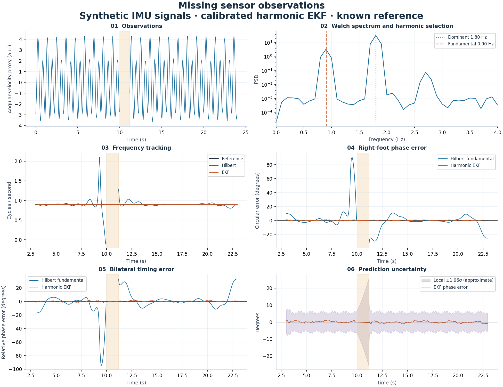

# Gait State Estimation Lab

**Signal processing, Fourier system identification and an Extended Kalman Filter for periodic IMU signals.**

A Python engineering project with a runnable synthetic demo, an EKF implemented in NumPy, explicit baselines and an optional gait-data benchmark. The demo runs without downloading a clinical dataset.

[CI runs](https://github.com/Giml0pb/Gait_Project/actions/workflows/ci.yml) · [Technical walkthrough](docs/technical_walkthrough.md) · [EKF equations](docs/phase_state_space.md) · [Benchmark results](docs/phase_validation_results.md)

## Run the demo

Requires Python 3.11+ and [uv](https://docs.astral.sh/uv/). Python 3.11 and 3.12 are exercised in CI.

```bash
uv sync --locked
uv run gait-lab demo
```

Open **`outputs/demo/report.html`** in a browser. The self-contained report lets you switch between five scenarios: stable coordination, changing frequency, changing bilateral timing, missing observations and waveform mismatch. It embeds its figures and needs no network connection to view them.

On Linux, open it from the terminal with `xdg-open outputs/demo/report.html`.



```bash
# One scenario, with a different noise level
uv run gait-lab demo --scenario sensor_dropout --noise 0.2 --seed 42

# Numerical outputs only
uv run gait-lab demo --scenario morphology_drift --no-figures

# Equivalent module entry point
uv run python -m gait_project demo
```

The demo exports time series, metrics, plots, identified Fourier coefficients and a manifest with parameters, dependency versions and source hashes. A separate synthetic calibration record supplies the observation template; the test record supplies observations and a known evaluation reference. The report also checks phase-uncertainty coverage and innovations over 20 seeded runs per waveform condition, with unchanged EKF noise settings.

[Checked-in numerical example](examples/synthetic/summary.json) · [Example metrics](examples/synthetic/metrics.csv)

## What is implemented

| Area | Implementation | Start reading |
| --- | --- | --- |
| Signal processing | Detrending, segment-aware Welch PSD, harmonic frequency selection, SOS Butterworth filters and Hilbert phase | [Spectral selection](src/gait_project/research/phase_estimators.py) |
| System identification | Least-squares Fourier observation templates, learned on separate calibration data | [Template fitting](src/gait_project/state_space/harmonic_ekf.py) |
| State estimation | Phase, angular frequency, amplitude and bias; nonlinear observation Jacobian; Joseph covariance update | [Harmonic EKF](src/gait_project/state_space/harmonic_ekf.py) |
| Missing observations | Prediction-only steps through gaps, with uncertainty propagation | [Dropout demo](src/gait_project/demo/run.py) |
| Validation | Seeded simulation, reference baselines, model-mismatch tests, participant-separated benchmark and one-to-one event matching | [Tests](tests/) |
| Delivery | Installable package, CLI, locked dependencies, Docker, CI and downloadable demo artifacts | [Workflow](.github/workflows/ci.yml) |

The two feet are estimated independently. The model does not impose bilateral synchronization. Its frequency initialization and preprocessing use offline information; the implementation demonstrates recursive estimation, not a validated real-time controller.

## Engineering decisions and results

- **The largest spectral peak is not necessarily the stride frequency.** A harmonic-rich waveform can place most power at twice the cycle frequency. The demo and benchmark make that ambiguity observable.
- **Prediction and correction are tested separately.** Missing samples cause prediction-only EKF steps. Hilbert abstains inside those gaps; coverage and prediction error are reported separately.
- **Initialization data are used once.** Two nominal cycles initialize phase, amplitude and bias. Recursive corrections start on the next sample; the bootstrap interval has no reported estimates.
- **A model can track the wrong interpretation.** Waveform changes can bias a fixed observation template while true bilateral timing stays constant. The mismatch scenario deliberately exposes this failure.
- **Small residuals do not guarantee correct uncertainty.** The [uncertainty check](src/gait_project/demo/uncertainty.py) reports phase coverage, innovation NIS and lag-1 correlation. A low NIS can coexist with strongly biased phase estimates.
- **The more complex method is not assumed to win.** In the optional 1,356-trial benchmark, Hilbert on the fundamental had lower median relative-phase error than this EKF: 8.89° versus 13.27°. The result is retained and documented.

The synthetic demo has a known phase reference. The clinical-data benchmark uses algorithm-derived events and measures agreement with that reference, rather than establishing clinical accuracy. See the [protocol](docs/phase_validation_protocol.md) for split design, support masks and limitations.

## Test and build

```bash
uv run pytest
uv run ruff check .
uv run ruff format --check .
uv build --wheel
```

CI runs the tests on Python 3.11 and 3.12, builds the wheel, executes the data-free demo and uploads the generated report. To inspect the report without setting up Python, download `synthetic-demo` from a successful [CI run](https://github.com/Giml0pb/Gait_Project/actions/workflows/ci.yml), extract it and open `report.html`.

## Docker

```bash
docker build -t gait-lab .
docker run --rm --network none -v "$PWD/outputs:/app/outputs" gait-lab
```

The default container command runs the synthetic demo and saves it under `outputs/demo/`. The example assumes the image was built with network access; runtime evaluation needs no network or clinical data. PowerShell users can replace `$PWD` with an absolute host output path.

## Optional dataset benchmark

Place the source dataset under `data/raw/dataset/data/`, following the [dataset guide](docs/dataset_structure.md), or pass `--data-dir`.

```bash
# Spectral/phase baseline, one trial
uv run python scripts/run_single_trial.py HS_1_1 --no-figures

# Full baseline with participant aggregation
uv run python scripts/run_batch_processing.py --all --output-dir outputs/baseline_run

# Dominant-band Hilbert vs fundamental-band Hilbert vs harmonic EKF
uv run python scripts/validate_phase_model.py --output-dir outputs/phase_study
```

Use a fresh output directory for each dataset run. Signals, participant-level outputs and generated run folders are excluded from Git. The repository includes aggregate figures and a [benchmark summary](examples/phase_validation/summary.json); the [results document](docs/phase_validation_results.md) explains what those numbers support.

## Project map

```text
src/gait_project/
├── demo/              Synthetic benchmark, figures and local HTML report
├── state_space/       Fourier observation model and harmonic EKF
├── spectral/          PSD and spectral features
├── phase/             Filtering, Hilbert attributes and quality masks
├── synchronization/   Circular and temporal coordination metrics
├── research/          Phase references, estimators and grouped validation
├── preprocess/        Signal cleaning, bilateral alignment and turn handling
├── io/                Dataset loading and atomic table writes
└── cli.py             Installed gait-lab command
```

[Documentation index](docs/README.md) · [Technical walkthrough](docs/technical_walkthrough.md)
