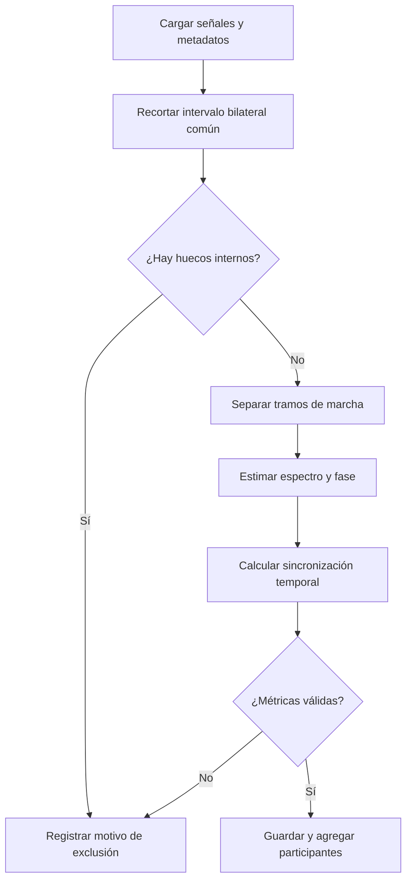

# Consolidación del pipeline de marcha

La versión 0.2.0 corrige el pipeline existente y establece una referencia verificable antes de introducir un estimador en espacio de estados con EKF. Las cifras históricas de la versión anterior no describen automáticamente esta versión.

## ✅ Cambios implementados

| Área | Comportamiento actual |
| --- | --- |
| Ejecución | Error de sintaxis corregido; CLI con rutas explícitas y códigos de salida |
| Datos ausentes | Recorte bilateral del relleno no finito en extremos; rechazo de huecos internos sin interpolación |
| Giro | PSD, filtrado e Hilbert independientes antes y después del giro; tiempos originales conservados |
| Fase | Exclusión de bordes en cada segmento; alineación temporal comprobada entre pies |
| Métricas temporales | Ventanas en tiempo real; saltos solo entre observaciones válidas adyacentes; pendiente por segundo |
| Validación | Esquemas ejecutados antes de exportar métricas; errores de esquema interrumpen el ensayo |
| Agregación | Media circular de direcciones; sesiones mezcladas identificadas; desviación de un solo ensayo indefinida |
| Persistencia | Escritura atómica por tabla; actualización por clave; carpeta nueva por ejecución batch |
| Trazabilidad | Parámetros, entorno, versión y hashes de código y de entradas |
| Pruebas | Datos sintéticos, regresiones numéricas, persistencia y ejecución completa de CLI; CI sin datos privados |



El recorte no recupera muestras inexistentes: conserva únicamente el intervalo donde ambos giroscopios tienen observaciones finitas. Los índices del giro y los tiempos siguen referidos al registro original. Un segmento conservado debe durar más de dos segundos; cada ventana de PLV necesita al menos la mitad de sus muestras válidas. El denominador de saltos de fase es la exposición observable entre pares adyacentes válidos.

La agregación entre ensayos asigna el mismo peso a cada ensayo del participante. La media de las direcciones de fase usa vectores unitarios; direcciones cuyo vector resultante es prácticamente cero tienen media indefinida. `anti_phase_error_deg` sigue siendo el promedio de errores escalares por ensayo y no se reemplaza por el error de la dirección media. Al mezclar sesiones, `session` y la puntuación clínica de sesión quedan vacías; `n_sessions` conserva esa información.

## 🧪 Verificación

Validación local realizada el 26 de octubre de 2026, con Python 3.11 y las versiones fijadas en `uv.lock`.

| Comprobación | Resultado |
| --- | --- |
| `uv run --locked pytest -q` | 38 pruebas superadas |
| Ruff y formato sobre código mantenido | Sin errores |
| Sintaxis de Python y del lanzador POSIX | Correcta |
| Reprocesamiento completo | 1.356 de 1.356 ensayos procesados; cero errores |
| Participantes | 260: 73 sanos, 143 neurológicos y 44 ortopédicos |
| Ensayos por grupo | 360 sanos, 784 neurológicos y 212 ortopédicos |
| Recuperación frente al resultado histórico | 369 ensayos adicionales; todos necesitaban recorte bilateral de extremos |
| Tablas por fase | 1.356 filas espectrales, 2.712 de fase y 1.356 de sincronización; sin claves duplicadas |
| Agregación angular | Medias circulares verificadas contra las fases de los ensayos de cada participante |
| Repetibilidad | Dos ejecuciones completas producen el mismo CSV maestro, comprobado con pandas |
| Trazabilidad | Todos los hashes de fuente coinciden con los archivos utilizados |
| Figuras | 26 figuras generadas para `HS_1_2`; espectrograma y PLV temporal inspeccionados |
| Docker | Imagen construida; ensayo `HS_1_2` ejecutado sin red y con datos montados en solo lectura; PLV idéntico al local |

Las salidas definitivas quedan en `outputs/baseline_v2/`. Se conservan tanto las salidas históricas bajo `outputs/tables/` como la primera ejecución de comprobación en `outputs/baseline_v2_initial_validation/`. El ejemplo con figuras queda en `outputs/baseline_v2_figures/`.

El manifiesto y `exclusions_by_group.csv` registran la ejecución completa. Las comparaciones con el resultado histórico describen éxito de procesamiento; no demuestran exactitud clínica. La comprobación local se hizo en Linux; en aquella comprobación el workflow de CI estaba configurado para Python 3.11 y 3.12, pero aún no se había ejecutado en GitHub. El lanzador Windows se revisó sin ejecutarlo en Windows.

Para repetir el análisis con la misma configuración:

```bash
uv sync --locked
uv run --locked pytest -q
uv run python scripts/run_batch_processing.py --all --output-dir outputs/baseline_replicate
uv run python scripts/analyze_metrics.py --input outputs/baseline_replicate/tables/patient_aggregated_metrics.csv
```

Las pruebas cubren los límites angulares, el relleno bilateral asimétrico, los huecos temporales, las unidades de la pendiente, la ausencia de ventanas utilizables, el rechazo de resultados inválidos antes de exportarlos, la actualización sin duplicados y la CLI con manifiesto. Los ensayos sintéticos no sustituyen una validación biomecánica con referencias independientes.

## ⚠️ Límites pendientes

- `phase_slip_rate` es cero en los 1.356 ensayos con la regla actual de saltos mayores de 90° entre muestras válidas adyacentes. Esta regla mide saltos abruptos de la fase filtrada; no detecta necesariamente deslizamientos graduales de un ciclo. No aporta discriminación en esta ejecución y necesita una definición y validación específica antes de interpretarse como inestabilidad clínica.
- Hay 109 ensayos con el indicador de diferencia de frecuencia activado. Se conservan con su bandera; debe considerarse su trayectoria de fase al interpretar la sincronización.
- El método de Hilbert sigue dependiendo de la banda seleccionada, de la convención de sensores y de la máscara adaptativa. Esa selección favorece coherencia espectral y baja variabilidad; se necesitan análisis de sensibilidad para interpretar diferencias patológicas.
- La exclusión fija de un segundo en los bordes es una elección operativa; no demuestra que todos los transitorios del filtro hayan desaparecido.
- Cadencia y tiempos de zancada con nombres históricos son proxies de frecuencia y periodo de oscilación. Falta contrastarlos con los eventos anotados.
- La media entre ensayos no modela evolución longitudinal ni reemplaza un análisis por sesión o un modelo jerárquico.
- Los tests entre grupos existentes son exploratorios. No se han regenerado inferencias clínicas ni afirmaciones de discriminación.
- La escritura es atómica por archivo y está diseñada para un único proceso escritor. No hay transacción conjunta entre todas las tablas ni reanudación automática de ejecuciones interrumpidas.
- El dataset y los resultados individuales están excluidos de Git. Una clonación puede ejecutar los tests sintéticos; para reproducir el análisis empírico necesita los datos autorizados.

## 📍 Siguiente etapa

Conservar esta versión como referencia y añadir el EKF como estimador independiente. Su evaluación deberá incluir fase conocida en simulación, cambios de frecuencia, ruido, pérdidas de observaciones y comparación por participante con el método de Hilbert. El modelo deberá permitir asimetría y pérdida de sincronización entre pies.

## 🔎 Comprobación científica posterior

El [estudio posterior de validez de fase](phase_validation_results.md) confirma que el pico dominante suele corresponder al segundo armónico de la zancada. Esto obliga a revisar la interpretación biomecánica de la fase y del desplazamiento fijo entre pies. La consolidación 0.2.0 verifica ejecución y consistencia numérica; no establece esa interpretación como validada. El estudio compara una referencia de fundamental y un prototipo EKF sin sobrescribir los resultados de esta versión.
