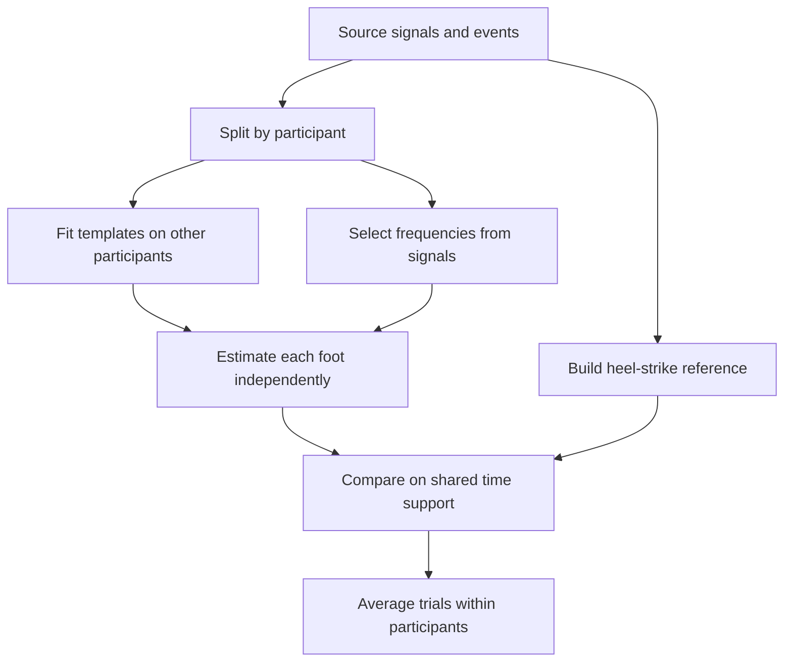

# Exploratory gait-phase validation

_Comparison protocol and scope — 28 October 2026_

---

## 🎯 Question

How much does measured bilateral coordination depend on tracking the dominant spectral peak rather than the stride cycle? This study checks the meaning of the estimated variable and the behavior of three estimators. Differences between diagnostic groups are not taken as evidence of a physiological mechanism.

The harmonic issue was identified while exploring this dataset. Participant separation prevents leakage when fitting templates, but does not turn a question developed on these data into a confirmatory hypothesis test.

## 🔬 Design

The established spectral/Hilbert baseline and its outputs are preserved. The comparison runs through `scripts/validate_phase_model.py`, producing separate tables, figures and a manifest with seeds, settings, source hashes and input hashes.



Five seeded folds are stratified by pathology. All sessions and trials from one participant stay together. Templates for each fold use signals and events from the other participants: coefficients are averaged first across trials within each person, then across people. Hyperparameters are not optimized against held-out annotations. A two-participants-per-cohort pilot checks execution only and is not presented as independent validation or used to tune the EKF.

Initial frequency and harmonic selection use the observed signal without consulting held-out trial events. Those events enter evaluation only. A regression test changes held-out annotations and verifies that the training template is unchanged.

## ⚙️ Methods

| Method | Definition |
| --- | --- |
| Dominant-band Hilbert | Welch dominant peak between 0.5 and 3 Hz, using 256-sample windows at the original sampling rate; retains the historical right-foot shift of pi |
| Fundamental-band Hilbert | Frequency between 0.25 and 2 Hz selected by summed power at three harmonics, with a small preference for fundamental support; Hilbert phase extracted around that frequency |
| Harmonic EKF | Phase, angular frequency, positive amplitude and offset states; three-harmonic periodic observation template trained on other participants |

Hilbert phase origins are calibrated from training-template coefficients: the first harmonic for the fundamental comparator and the second for the dominant comparator. The latter preserves historical band selection and phase convention, but does not exactly reproduce old CSV outputs because this study resamples and applies a shared scoring mask. Second-harmonic phase and stride phase are different cycle variables; a large error between them does not by itself show an implementation defect.

Signals are trimmed to the common finite bilateral interval and processed separately before and after the turn. The study resamples to 25 Hz with antialias filtering; the dominant peak is selected beforehand at the original rate. Harmonic selection uses long spectral windows. Zero-padding interpolates the frequency grid without increasing independent spectral resolution. Fundamental power fraction is exported; support below 5% is flagged without silently excluding the record.

The EKF treats feet independently without imposed antiphase or coupling. It uses the Joseph covariance update, prediction-only steps for missing observations, and counted contacts with operational frequency/amplitude bounds. Normalized observation-noise standard deviation is 0.15; frequency diffusion is 0.025 Hz per square root of second. These covariances are not assumed calibrated.

Initialization profiles a phase grid over two nominal active-signal cycles, with a minimum of two seconds, and fits amplitude and offset by least squares. Those observations are reserved for initialization; recursive corrections start at the next sample. The bootstrap interval is excluded from all three estimators' scores. One second is also excluded at each observed-segment edge, including synthetic gaps. Initial frequency uses the full observed signal and resampling is offline: recursive updates do not make this a real-time comparison.

The [EKF formulation](phase_state_space.md) defines equations, units and identifiability limits.

## 📏 References and metrics

Consecutive same-foot heel strikes define one reference cycle with phase progressing linearly between them. The reference does not interpolate across turns or outside complete cycles. It is an event-based timing convention, not a unique biomechanical phase trajectory.

Dataset events were detected algorithmically rather than independently measured for every recording.[^dataset] Dataset errors therefore express agreement with that reference. Only simulations supply known generative phase.

Predicted heel strikes are increasing phase crossings of integer cycles. They are matched one-to-one with annotations within 150 ms. Unmatched predictions are false positives and unmatched observed reference events are false negatives. F1 is reported alongside matched-event timing error, which alone could hide duplicate cycles. The 150 ms tolerance is operational and is not proposed as a clinical threshold.

Primary metrics are selected-frequency/event-stride-frequency ratio and absolute circular relative-phase error. All three estimators use the same scored samples, requiring at least one second of shared support. Support sizes and unscorable records are reported. Foot-level phase error, PLV and event-reference PLV are also exported. Trials are averaged within participants before summarizing distributions; 1,356 recordings are not treated as 1,356 independent people.

No diagnostic-group p-values are used to claim clinical discrimination. Age, rhythm, sensor effects and diagnostic composition remain possible alternative explanations. Held-out errors are not used to force an EKF advantage.

## 🧪 Simulations

Five scenarios—fixed asymmetry, changing waveform at fixed coordination, timing drift, frequency modulation and sensor dropout—are combined with four second-harmonic ratios (0.5, 1, 3, 6), two noise levels and five seeds per combination: 200 cases evaluated by three methods.

The study's simulated EKF receives the known initial generative template. This represents ideal calibration and favors it relative to a new-participant setting. Waveform change deliberately breaks that assumption. The runnable demo separately fits its template on an independent synthetic calibration record. Gap prediction is evaluated separately with error and coverage: missing Hilbert predictions are not scored as zero error.

An exact identifiability check verifies that even-only harmonics produce identical observations at phases separated by half a stride. Small covariance or accurate signal reconstruction does not remove that ambiguity. The EKF flags ambiguous initialization while retaining a unimodal approximation.

## 🔁 Reproduction

```bash
uv run python scripts/validate_phase_model.py --output-dir outputs/phase_study
uv run pytest
```

Use an empty output directory. An execution pilot can use a separate path with `--max-subjects-per-cohort 2 --folds 2 --simulation-repetitions 1`. The [results](phase_validation_results.md) report the complete comparison and its limitations.

## 🔗 References

[^dataset]: Voisard et al. (2025). A Dataset of Clinical Gait Signals with Wearable Sensors from Healthy, Neurological, and Orthopedic Cohorts. https://www.nature.com/articles/s41597-025-05959-w
