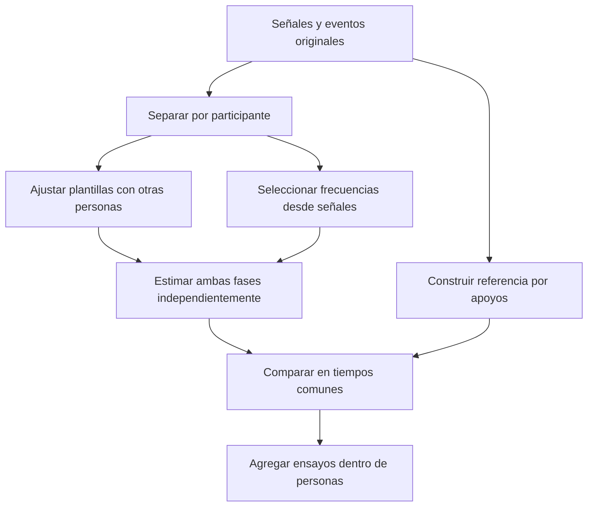

# Validación exploratoria de la fase de marcha

_Protocolo y alcance de la comparación — 28 de octubre de 2026_

---

## 🎯 Pregunta

¿Cuánto depende la medida de coordinación bilateral de seguir el pico dominante de la señal, en vez del ciclo de zancada? El objetivo inmediato es comprobar el significado de la variable estimada y el comportamiento de tres estimadores. La existencia de diferencias entre diagnósticos no se considera confirmación de un mecanismo fisiológico.

El problema de los armónicos se detectó explorando este mismo dataset. Por tanto, este estudio es exploratorio; la separación por participantes evita filtración en el ajuste de plantillas, pero no transforma una hipótesis generada sobre estos datos en una prueba confirmatoria.

## 🔬 Diseño

Se conservan sin sobrescribir el pipeline 0.2.0 y sus salidas. La comparación se ejecuta con `scripts/validate_phase_model.py`, genera tablas y figuras propias e incluye manifiesto, semilla y hashes de código y entradas.



Se utilizan cinco particiones determinadas por semilla y estratificadas por patología. Todas las sesiones y los ensayos de una persona permanecen juntos. Las plantillas de cada partición se ajustan exclusivamente con eventos y señales de las otras personas: primero se promedian coeficientes entre ensayos de la misma persona, y después entre personas. No se ajustan hiperparámetros mediante las anotaciones del grupo evaluado. El piloto con dos personas por cohorte sirve para verificar la ejecución; no se presenta como evidencia independiente ni se usan sus errores para optimizar el EKF.

La frecuencia inicial y la selección de armónicos se calculan sin consultar los eventos del ensayo evaluado. Los eventos de ese ensayo sólo intervienen al calcular las métricas. Esta distinción también se comprueba con una prueba que altera las anotaciones de la persona excluida sin cambiar la plantilla de entrenamiento.

## ⚙️ Métodos

| Método | Definición |
| --- | --- |
| Hilbert dominante | Selección de pico entre 0,5 y 3 Hz con Welch de 256 muestras a la frecuencia original; conserva el desplazamiento derecho de pi de la convención histórica |
| Hilbert fundamental | Selección de frecuencia entre 0,25 y 2 Hz mediante suma de potencia de tres armónicos, con preferencia mínima por soporte en la fundamental; fase extraída alrededor de esa frecuencia |
| EKF armónico | Estado de fase, frecuencia angular, amplitud positiva y sesgo; observación periódica con tres armónicos y plantilla aprendida en otras personas |

Las fases de Hilbert se calibran a un origen compartido mediante los coeficientes de las plantillas de entrenamiento: primer armónico para la fundamental y segundo para el dominante. El comparador dominante conserva la selección de banda y la convención histórica, pero no reproduce exactamente los CSV anteriores: hay remuestreo y una máscara común de evaluación. Una fase del segundo armónico y una fase de zancada son magnitudes distintas; un error grande entre ellas evidencia esa diferencia de definición y no demuestra por sí solo que un algoritmo esté mal implementado.

Las señales se recortan al intervalo bilateral finito y se analizan antes y después del giro de forma independiente. Se remuestrean a 25 Hz con filtrado antialias para el estudio. El pico dominante se selecciona previamente a la frecuencia original. La suma armónica utiliza espectros con ventanas largas; el relleno de ceros interpola la rejilla espectral sin aumentar su resolución independiente. La fracción de potencia en la fundamental se exporta; valores inferiores al 5% se marcan como soporte débil, sin descartarlos de manera oculta.

El EKF estima cada pie por separado, sin imponer antifase ni una fuerza de acoplamiento. Utiliza actualización de covarianza de Joseph, predicción cuando falta una observación y límites operativos de frecuencia y amplitud cuyos contactos se contabilizan. El ruido de observación normalizado es 0,15; la difusión de frecuencia es 0,025 Hz por raíz de segundo. No se afirma que esas covarianzas estén calibradas.

La inicialización perfila una rejilla de fases durante dos ciclos nominales de señal activa, con un mínimo de dos segundos, y estima amplitud y sesgo por mínimos cuadrados. Ese intervalo se reserva para el ajuste: las correcciones recursivas comienzan en la muestra siguiente, sin reutilizar sus observaciones. Se excluye ese calentamiento de los tres métodos. También se excluye un segundo en cada extremo de los segmentos observados, incluidos los bordes de huecos sintéticos. La frecuencia inicial usa la señal observada completa y el remuestreo es fuera de línea: esta es una comparación **offline**, aunque la actualización del EKF sea recursiva.

La formulación matemática, las unidades y las limitaciones de identificabilidad están en [phase_state_space.md](phase_state_space.md).

## 📏 Referencias y métricas

Cada intervalo entre dos apoyos consecutivos del mismo pie define un ciclo de referencia, con fase que avanza linealmente entre ambos apoyos. No se interpola entre giros ni fuera de ciclos completos. Esta fase es una convención temporal por eventos; no establece la trayectoria de una fase biomecánica única dentro de cada zancada.

Los eventos del dataset se obtuvieron automáticamente mediante algoritmos de detección, no mediante una referencia experimental independiente para cada registro.[^dataset] Por ello, los errores reales se interpretan como concordancia con esa referencia. Sólo las simulaciones proporcionan una fase generativa conocida.

Los apoyos se predicen mediante cruces crecientes de la fase por múltiplos de un ciclo y se emparejan uno a uno con los eventos anotados dentro de 150 ms. Los cruces sobrantes cuentan como falsos positivos, y los eventos no emparejados como falsos negativos. Se publica F1 junto con el error temporal de los eventos emparejados; ese error por sí solo podría ocultar duplicaciones de ciclo. El umbral de 150 ms es operativo y debe someterse a sensibilidad, no se propone como límite clínico.

Las métricas principales son el cociente entre frecuencia seleccionada y frecuencia de zancada por eventos, y el error angular absoluto de la fase relativa. Se calculan sobre las mismas muestras para los tres estimadores, con al menos un segundo de soporte común. Se publican los tamaños de soporte y los casos no evaluables. Las tablas incluyen también el error de fase por pie, PLV y su referencia por eventos. Los ensayos se promedian dentro de cada participante antes de resumir distribuciones; no se tratan las 1.356 grabaciones como 1.356 personas independientes.

No se usan los errores reales para decidir que el EKF debe ganar. No se prueban diferencias clínicas con valores p ni se atribuyen efectos a una patología: edad, ritmo, sensor y composición diagnóstica siguen siendo posibles explicaciones alternativas.

## 🧪 Simulaciones

Se combinan cinco escenarios —asimetría fija, cambio de forma sin cambio de coordinación, deriva temporal, modulación de frecuencia y pérdida de sensor— con cuatro proporciones de segundo armónico (0,5; 1; 3; 6), dos niveles de ruido y cinco semillas por combinación: 200 casos y tres métodos por caso.

En la simulación el EKF recibe la plantilla generativa inicial conocida: representa una calibración ideal y favorece al modelo respecto al problema de personas nuevas. El escenario de cambio de forma rompe intencionadamente esa hipótesis. La predicción durante pérdidas se evalúa por separado, con error y cobertura: Hilbert se abstiene en el hueco y no se compara su error inexistente con un cero.

Se incluye además una comprobación exacta de identificabilidad: cuando sólo hay armónicos pares, dos fases separadas por media zancada producen la misma observación. Una covarianza pequeña o una señal reconstruida con precisión no resuelven esa ambigüedad. El EKF señala inicializaciones ambiguas, pero mantiene una aproximación unimodal.

## 🔁 Reproducción

```bash
uv run python scripts/validate_phase_model.py --output-dir outputs/phase_validation
uv run pytest
```

La carpeta debe estar vacía. El piloto puede ejecutarse en otra ruta con `--max-subjects-per-cohort 2 --folds 2 --simulation-repetitions 1`. La comparación completa y sus límites se describen en [phase_validation_results.md](phase_validation_results.md).

## 🔗 Referencias

[^dataset]: Voisard et al. (2025). A Dataset of Clinical Gait Signals with Wearable Sensors from Healthy, Neurological, and Orthopedic Cohorts. https://www.nature.com/articles/s41597-025-05959-w
