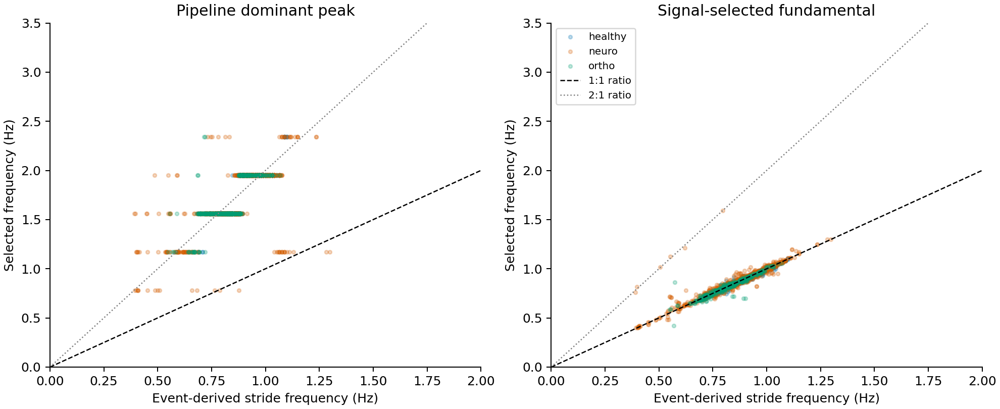
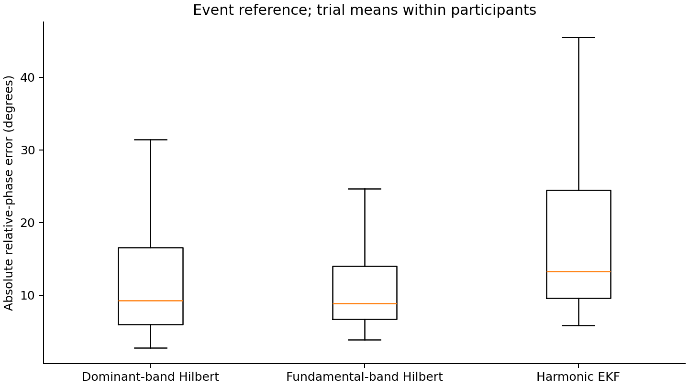
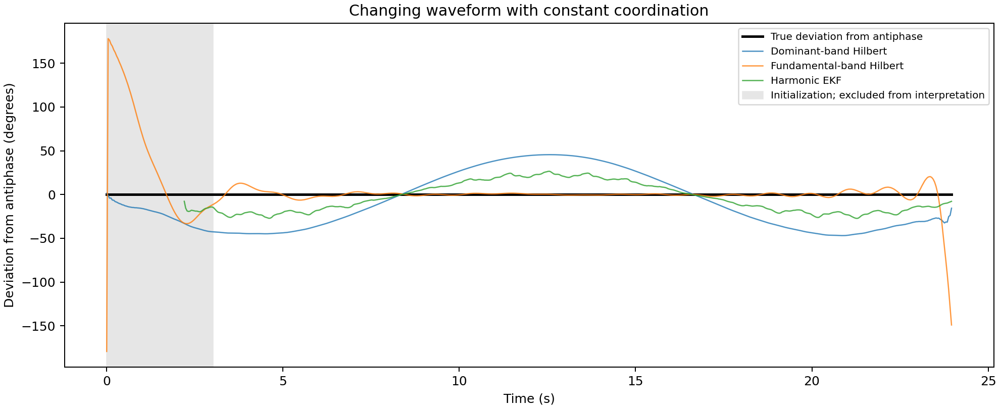

# Exploratory phase-validation results

_Complete run: 28 October 2026; study 0.2.0, package 0.3.1_

---

## 📋 Main finding

The baseline's dominant spectral peak usually tracks a component near the second stride harmonic. Signal-only fundamental selection improves frequency agreement and heel-strike counting. The implemented harmonic EKF does not improve the primary relative-phase agreement metric over fundamental-band Hilbert. Its smaller timing error among matched events is secondary and does not automatically compensate for missed or extra events.

Simulation also shows that waveform changes can produce apparent coordination changes while generative bilateral timing stays constant. This identifies a methodological vulnerability; it does not establish that real diagnostic-group differences are artifacts.

## 🔬 Scope and checks

The study prepared and compared 1,356 trials from 260 participants using five participant-separated folds, keeping each person's sessions together. Templates used the other 208 participants in each fold. No processing exceptions occurred. Two trials from one healthy participant had less than one second of shared bilateral support after initialization: relative-phase distributions therefore contain 1,354 trials and 259 participants. Foot-level evaluation has 2,709 scored foot-trial observations per method out of 2,712 available; participant-level event summaries include all 260 people.

The complete test suite passes 67 tests. Checks cover formatting, lint, participant separation, source hashes and disjoint bootstrap/correction samples. This run repeats the full benchmark after the initialization correction without retuning noise settings. Established baseline outputs are preserved.

The [protocol](phase_validation_protocol.md) and [EKF formulation](phase_state_space.md) describe settings, units, masks, calibration and identifiability. Local outputs are under `outputs/phase_validation_v031/`; committed aggregate results and numerical figure data come from that run.

## 📈 Frequency and cycle interpretation

Across 2,712 foot-trial observations, the median dominant-peak/event-stride-frequency ratio is **2.0117**. The median signal-selected-fundamental ratio is **0.9996**; 2,686 observations lie within ±10% of event-derived stride frequency. Two observations have weak fundamental support.

The 5th–95th percentile ratio range is 1.781–2.207 for the dominant peak and 0.973–1.035 for the fundamental. This supports the interpretation that the older method mainly tracks the second harmonic. Simply dividing every dominant frequency by two would be inappropriate because harmonic order can change across signals and conditions.

A previous interpretation of bilateral in-phase signals as evidence of mirrored sensor orientation needs reconsideration: stride-level antiphase also becomes in-phase at the second harmonic. A fixed pi shift does not resolve that cycle-definition ambiguity.



## 📏 Agreement with event references

Relative-phase error uses identical scored samples for all three methods. Trial errors are averaged within each participant, then summarized across the 259 evaluable people. The table reports median and interquartile range, not a statistical superiority test.

| Method | Median relative-phase error | 25th–75th percentiles |
| --- | ---: | ---: |
| Dominant-band Hilbert | 9.28° | 5.98–16.53° |
| Fundamental-band Hilbert | 8.89° | 6.71–13.98° |
| Harmonic EKF | 13.27° | 9.58–24.42° |

The central difference between Hilbert variants is small for this criterion. In healthy participants, the descriptive median even favors the dominant comparator (6.19° versus 7.26°). Fundamental selection is not claimed to improve every metric or subgroup. The EKF distribution is wider, with a 75th percentile of 24.42°.



Predicted heel strikes are matched one-to-one within 150 ms. The following values are medians across 260 participants. Each participant's F1 combines false positives, false negatives and true positives over their feet and trials; matched-event timing error is weighted by the number of matched events within that participant.

| Method | Event F1 | Matched-event timing error |
| --- | ---: | ---: |
| Dominant-band Hilbert | 0.634 | 20.9 ms |
| Fundamental-band Hilbert | 0.975 | 28.9 ms |
| Harmonic EKF | 0.972 | 23.1 ms |

The dominant comparator has small matched-event timing error but produces 38,028 extra crossings. Reporting nearest-event proximity alone would hide the incorrect cycle count. Fundamental selection reduces false positives to 3,622 and the EKF to 3,274. These pooled event counts are not independent participant observations.

The EKF flags 12 ambiguous initializations. Frequency bounds are reached in 126 foot-trial observations, and amplitude bounds in 256. These count contacts at any point during recursive tracking, including transients; they are not counts of clinical failures.

## 🧪 Known-phase simulation

The study evaluated 200 scenario/waveform/noise/seed combinations with all three methods. Its EKF receives the initial generative template, representing ideal calibration unavailable for every new participant. The table summarizes median relative-phase error in degrees, combining four harmonic ratios and two noise levels per scenario.

| Scenario | Fundamental-band Hilbert | Harmonic EKF |
| --- | ---: | ---: |
| Fixed asymmetry | 2.73° | 0.77° |
| Changing waveform, fixed coordination | 3.44° | 15.62° |
| Timing drift | 2.95° | 0.94° |
| Frequency modulation | 3.50° | 1.77° |
| Sensor dropout | 3.77° | 0.74° |

The model works well when its template is appropriate, but waveform change degrades it even when true coordination is constant. During synthetic 1.2 s gaps, the EKF maintains predictions with median phase error of 0.77°. Hilbert abstains inside gaps; missing predictions are reported as zero coverage rather than zero error.

Dominant-band results are also retained. Combining first-harmonic-dominant and second-harmonic-dominant cases changes the interpretation of its fixed right-foot pi shift. Its overall stride-reference phase error mixes cycle-definition differences with tracking error and is not a pure algorithmic-accuracy comparison.



The plot includes edge transients excluded from scoring. With even-only harmonics, the maximum difference between observations at a phase and that phase plus pi is 3.33 × 10⁻¹⁶: indistinguishable at numerical precision. That observation cannot uniquely identify the half-cycle branch.

## ⚠️ Interpretation and limits

Dataset events come from automatic detectors.[^dataset] Continuous phase has not been validated against independent optical motion capture or force-platform measurements. Linear interpolation between heel strikes is a useful timing reference, not biomechanical ground truth throughout the cycle.

Processed dataset files already include filtering and interpolation of some original gaps.[^dataset] Synthetic dropout tests do not establish performance on naturally missing raw observations. Prototype initialization and preprocessing are offline.

Parameters were not optimized to obtain an EKF win. Results describe this prototype with a fixed population template, not a limit on state-space models generally. Its covariance is not calibrated as clinical uncertainty. Population-template mismatch, between-person waveform differences and initialization remain possible explanations requiring targeted tests.

The [demo's uncertainty check](technical_walkthrough.md#check-the-uncertainty) separately evaluates known-phase coverage and innovations. Low innovation NIS can coexist with biased phase under waveform change; those diagnostics do not establish clinical calibration.

This study is exploratory, and the harmonic question arose on the same dataset. Folds control template fitting but do not remove that earlier question-selection step. No confirmatory conclusions are drawn about pathology, age, speed or neural control, and no physiological coupling strength is estimated.

## 📍 Technical conclusion

The signal-selected fundamental is the more defensible reference for stride cycles and heel strikes, while the dominant peak remains a distinct spectral measure. Its F1 improvement is descriptively clear; the central relative-phase improvement is small and varies across groups.

This benchmark does not justify replacing the simpler phase reference with the EKF for bilateral-coordination analysis. It does provide a reproducible comparison, a working recursive estimator and explicit observation-model failures that can be examined technically.

## 🔁 Artifacts and reproduction

Tables, four figures, summary and manifest are generated locally; source signals and participant-level results are not versioned. The processing-error table is empty, and insufficient-support cases are identified explicitly. Tests cover frequency recovery, harmonic ambiguity, gap prediction, separate initialization, uncertainty coverage, participant leakage and one-to-one event matching.

```bash
uv run python scripts/validate_phase_model.py --output-dir outputs/phase_validation_replicate
uv run pytest
```

The [committed summary](../examples/phase_validation/summary.json) records aggregate numerical results. The [dataset guide](dataset_structure.md) describes the optional source data.

## 🔗 References

[^dataset]: Voisard et al. (2025). A Dataset of Clinical Gait Signals with Wearable Sensors from Healthy, Neurological, and Orthopedic Cohorts. https://www.nature.com/articles/s41597-025-05959-w
