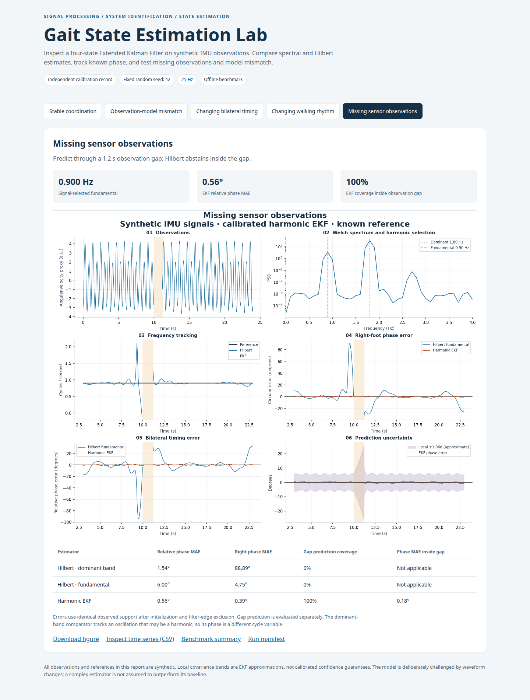
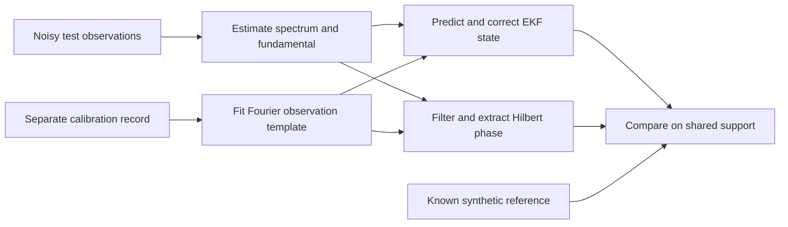

# Technical walkthrough

_A short route through the signal-processing and state-estimation implementation._

## Start with a working system

```bash
uv sync --locked
uv run gait-lab demo --scenario sensor_dropout
```

Open `outputs/demo/report.html`. The plot, CSV and manifest come from the same run. To see a controlled failure, repeat with `--scenario morphology_drift`: waveform shape changes while the true bilateral timing stays fixed.

The checked-in [synthetic results](../examples/synthetic/summary.json) use seed 42, observation noise 0.1 and a second-harmonic amplitude ratio of 3. They can be regenerated with:

```bash
uv run gait-lab demo
uv run python scripts/export_showcase.py
```



## Follow the data



Read [demo/run.py](../src/gait_project/demo/run.py) for orchestration. It generates independent calibration and evaluation records, identifies the template, selects frequencies, invokes the estimators and exports their shared evaluation mask. Ground-truth evaluation phase is not passed to the test-record estimator.

For the optional dataset benchmark, training templates use different people from the evaluated participant. All sessions of one participant remain in the same fold. That benchmark uses detected gait events as a reference, rather than independent biomechanical ground truth.

## Signal processing

[phase_estimators.py](../src/gait_project/research/phase_estimators.py) contains the signal-only fundamental selector and Hilbert comparator. Important choices are explicit:

- A dominant peak can represent the second harmonic. A three-harmonic power sum provides an alternative fundamental estimate and exports its power-support diagnostic.
- Finite segments are processed independently. Neither spectral windows nor filters cross an observation gap or a turn.
- SOS Butterworth filtering precedes the Hilbert transform. The comparison excludes initialization and filter edges from all methods equally.
- Hilbert leaves missing observations undefined. An undefined estimate is reported as missing coverage, not zero error.

The dataset loader and [trial preparation](../src/gait_project/preprocess/trial_signal.py) additionally align the finite bilateral interval, preserve original sample times and reject internal missing data in the established dataset pipeline. Synthetic gaps are introduced separately for estimator stress tests.

## System identification

[fit_template](../src/gait_project/state_space/harmonic_ekf.py) fits sine and cosine Fourier coefficients by least squares against a calibration phase. The demo uses a separate synthetic calibration record with known phase. The real-data study learns templates from other participants.

The Fourier coefficients describe observation shape; they are not the EKF state. The EKF updates phase, frequency, positive amplitude and offset while keeping that learned shape fixed. The mismatch scenario tests exactly where that assumption fails.

## Extended Kalman Filter

The state is `[phase_rad, angular_frequency_rad_s, amplitude, bias]`. Frequency drives phase through the state transition; the observation is a nonlinear periodic function of phase. An EKF is needed because the observation model is nonlinear even though the transition matrix is linear.

The implementation in [harmonic_ekf.py](../src/gait_project/state_space/harmonic_ekf.py) uses NumPy directly:

1. Propagate state and covariance through the transition and process noise.
2. Evaluate the Fourier observation and its analytic derivative.
3. Compute innovation, innovation variance and Kalman gain.
4. Correct state and apply the Joseph covariance update.
5. For missing observations, retain the prediction and skip correction.

Each foot is estimated independently. Relative phase is calculated afterwards; expected synchronization is never imposed on the estimator. Frequency and amplitude bounds and ambiguous initializations are exposed as diagnostics.

```python
import numpy as np
from gait_project.state_space.harmonic_ekf import HarmonicTemplate, estimate_phase_ekf

fs = 25.0
phase = 2 * np.pi * 0.9 * np.arange(600) / fs
template = HarmonicTemplate([0, 1, -0.2, 3, 0.9, 0.15, 0])
observations = template.evaluate(phase)
observations[250:280] = np.nan

result = estimate_phase_ekf(observations, fs, 0.9, template)
# result.phase remains defined during the missing-observation interval.
# result.variance_phase grows while correction is unavailable.
```

The [mathematical note](phase_state_space.md) defines the transition, observation Jacobian, noise scaling and circular error. Its explanatory text is in Spanish. The EKF is an offline benchmark with recursive updates: full-record frequency initialization, normalization and filtering have not been converted into a streaming front end. Local covariance bands are approximate and have not been calibrated as confidence guarantees.

## Verification and evidence

[Tests](../tests/) cover finite-difference checks of the Fourier derivative, covariance propagation through missing data, reference recovery, harmonic ambiguity, circular boundaries, event matching, output integrity and installed CLI execution from outside the repository directory.

The [research benchmark](phase_validation_results.md) also retains the negative result: this population-template EKF did not outperform Hilbert fundamental on median bilateral phase error. This helps distinguish an implementation that is numerically correct from an observation model that fits every recording.

## Extend one component at a time

A different observation model belongs in `state_space/`; a new comparator belongs in `research/`. Preserve the known-phase simulation and participant separation when changing either one. Recompute the reference metrics and report missing coverage and model-bound contacts alongside error. The synthetic demo is the fast entry point; the optional dataset study checks behavior beyond the synthetic generator.
